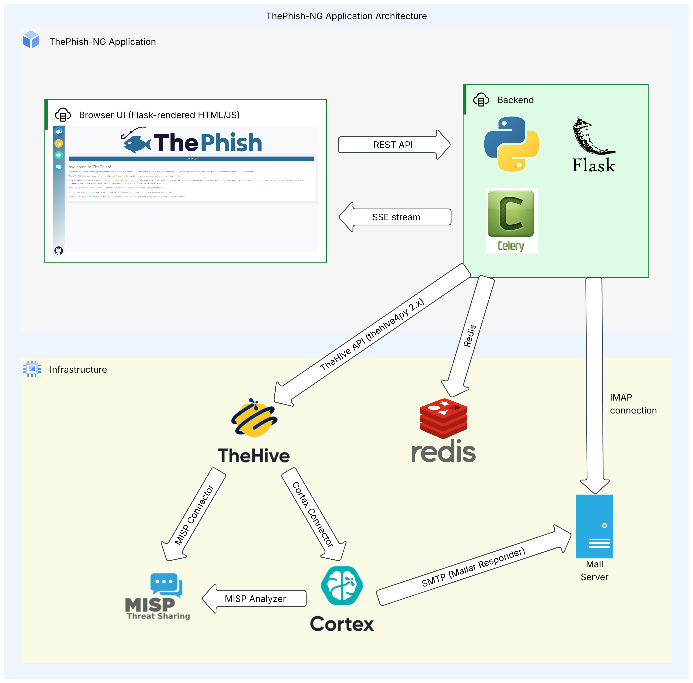

# ThePhish-NG

  

     
  

ThePhish-NG is a partial rewrite of the original [ThePhish](https://github.com/emalderson/ThePhish) project with updated features and TheHive 5 support.

It offers a web application built with Python 3 and Flask that automates phishing email analysis using TheHive, Cortex, and MISP.
It handles the full analysis flow from extracting observables, running the applicable analyzers, closing the TheHive case with a verdict and exporting malicious cases to MISP. 

## Table of contents

* [Additional Documentation](#additional-documentation)
* [External References](#external-references)
* [Highlighted Features](#highlighted-features)
* [Architecture](#architecture)
  * [Chart](#chart)
  * [Description](#description)
  * [Analysis Workflow](#analysis-workflow)
* [Credits](#credits)
* [License](#license)

## Additional Documentation

* [Usage Example](docs/usage-example.md)
* [Setup Guide](docs/setup.md)
* [Configuration Options](docs/configuration.md)

## External References

* Original ThePhish project: https://github.com/emalderson/ThePhish
* TheHive Documentation: https://docs.strangebee.com/thehive/overview/
* Cortex Documentation: https://docs.strangebee.com/cortex/
* TheHive & Cortex Docker: https://github.com/StrangeBeeCorp/docker
* MISP: https://www.misp-project.org/
* MISP Docker: https://github.com/MISP/misp-docker

## Highlighted Features

* TheHive 5 support
* Background analysis with live logs and configurable retention
* Extracts URLs, domains, IPs, hashes, and other email observables
* Adds attachments and the original EML to TheHive
* Follows redirects and decodes Microsoft 365 Safelinks
* Configurable whitelists, analyzer exclusions, and verdict mappings
* Automatic verdicts and IoC marking
* Exports malicious cases to MISP and keeps suspicious cases open for review
* Configurable start and result emails with an optional log and link to the web view

## Architecture

### Chart

  

     
  

### Description

The application is built with Python 3 and Flask. The web interface uses HTML, CSS and JavaScript with the support of Jinja templates and Bootstrap.

It follows a layered structure:

* It has two Flask blueprints. One (app.web) is responsible for resources for the browser, such as rendering the Jinja templates and serving static assets. The second blueprint (app.api) exposes the API endpoints used to list emails, start analyses and retrieve their progress.
* The service layer contains the business logic for listing emails and the individual stages of the analysis workflow.
* Access to IMAP, Redis and TheHive is encapsulated in repository modules which provide an abstraction for the service modules.
* There's also a utility layer for generic tasks such as observable extraction, whitelisting, Microsoft 365 SafeLink decoding, redirect tracking and analyzer result mappings.

The main part of an analysis is not executed inside the Flask thread as it can take several minutes. When an analysis is started, the API validates the supplied email UID, creates an analysis identifier, stores its initial state in Redis and queues a Celery task. A separate Celery worker then performs the analysis in the background. Redis is used as the Celery broker and result backend, as well as for storing analysis states, logs and live events.

The web interface communicates with the application through its JSON API. The main page retrieves the list of analyzable emails with an HTTP request. When the analyst starts an analysis, a POST request is sent and the user gets redirected to the persistent analysis page. This persistent page first loads the stored state, and then connects to an SSE stream to retrieve live updates if the analysis is still running.

The analysis state is stored independently of the browser connection so the page can be reloaded during the analysis without losing progress. Optionally, a link to this analysis page can be included in the result email or TheHive case so it can be reopened until the retention time is over.

### Analysis Workflow

1. The analyst requests the list of emails through the web interface. The application searches the configured mailbox for unread messages and returns the configured number of valid emails. An email is invalid if it doesn't contain an EML attachment or misses the required email headers. Invalid or oversized emails are omitted from the list and automatically marked as read so the next run doesn't re-scan them.
2. When the analyst selects an email, the browser sends its UID to the analysis API. The application creates a unique analysis identifier, stores a pending state in Redis and queues the background task. The browser is then redirected to the analysis page.
3. The Celery worker retrieves the selected message and marks it as read. Then it extracts the attached EML file and stores the sender of the parent message for notifications.
4. The application extracts the observables and attachments from the attached email. It removes whitelisted values and, if configured, decodes Microsoft SafeLinks and follows URL redirects.
5. The application creates a case template in TheHive (or reuses it if it already exists) and then creates a case. Extracted observables, attachments, the original EML, and optionally a link to the analysis page are added to the TheHive case. Failures affecting individual observables are logged as warnings without aborting the analysis.
6. If configured, the application sends a start of analysis notification to the submitter or the override recipient. It prefers the custom [PhishMailer responder](https://github.com/dead-plant/ThePhish-NG-Neurons/tree/main/responders/PhishMailer) and falls back to the standard Mailer responder if the preferred is not available.
7. Next, the application selects the analyzers to run. It retrieves the available analyzers for each observable type and filters out blacklisted analyzers. There are two additional rules:
   1. The EML is only analyzed by the Yara analyzer
   2. The DomainMailSPFDMARC is only applied to the sender domain.
8. All analyzer jobs are started one by one, and the application polls their statuses until they finish, fail or reach a timeout.
9. A verdict is calculated from the analyzer results. If the number of malicious observables is greater than or equal to the configured threshold, the verdict is malicious. If at least one observable is malicious or suspicious and the threshold isn't reached, it is suspicious; otherwise, it is safe.
10. Observables with malicious results are marked as IoCs in TheHive. Depending on the verdict and configuration, malicious cases might be exported to MISP and cases might be closed automatically. Otherwise, the case remains open so the analyst can review the analysis and close it manually.
11. After the case is finalized, an optional notification email is sent containing the configured content such as the verdict, summary, analysis log or a link back to the web view. Once the workflow completes, the final state and verdict are stored in Redis and displayed on the analysis page.

You might also want to check out the [Usage Example](docs/usage-example.md).

## Credits

* [emalderson](https://github.com/emalderson): Creator of the original ThePhish (upstream) project
* [stone](https://github.com/rmfstone): Co-Maintainer of the ThePhish-NG project
* [FabioHofstadler](https://github.com/FabioHofstadler): Logo and Designs

## License

ThePhish-NG is free and open-source software released under the [AGPL-3.0 license](LICENSE).
